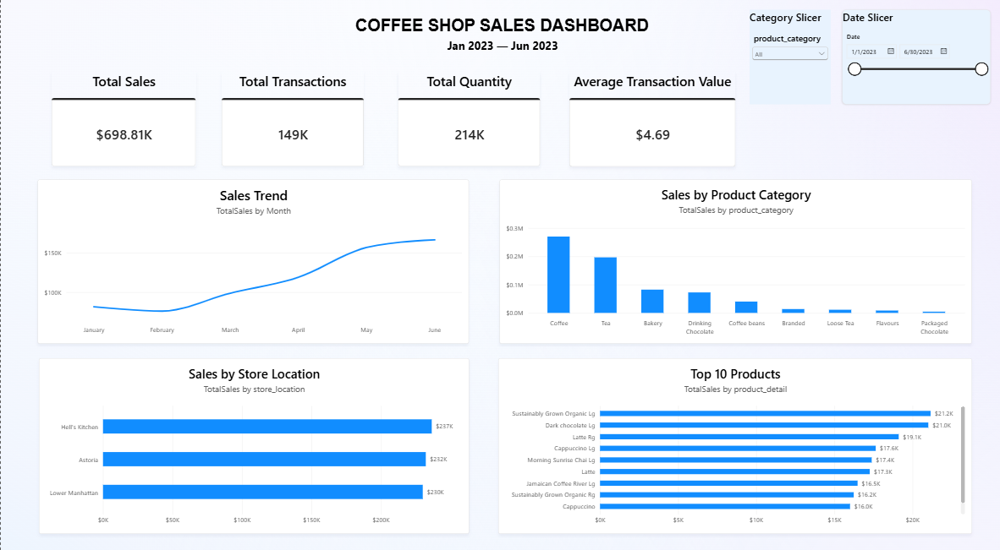
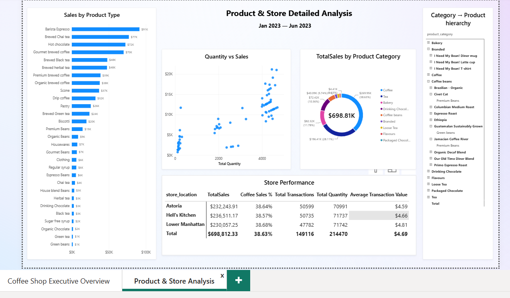

# ☕ Coffee Shop Sales Analysis

## Project Overview

This project analyzes the Maven Analytics Coffee Shop Sales dataset covering the period from January to June 2023.

The same raw dataset was independently analyzed using SQL Server and Microsoft Power BI to demonstrate different approaches to data analysis and business intelligence.

The project consists of two main components:

- SQL analysis focused on data quality checks, business metrics, and sales analysis.
- Power BI dashboard focused on data modeling, DAX measures, and interactive data visualization.

## Tools & Technologies

- SQL Server
- Microsoft Power BI
- DAX
- Power Query
- Excel / CSV

---

## SQL Analysis

The dataset was loaded into SQL Server and analyzed using SQL queries.

The analysis includes:

- Data quality checks
- Total revenue
- Average transaction value
- Monthly revenue
- Revenue by day of week
- Revenue by hour
- Number of transactions by hour
- Product quantity and revenue analysis
- Top 10 products by revenue
- Product category analysis
- Store performance analysis
- Average transaction value by month

The SQL analysis is available in:

`SQL/coffee_shop_sales_analysis.sql`

---

## Power BI Dashboard

The same raw dataset was loaded directly into Power BI.

The dashboard was developed independently from the SQL analysis using the Power BI data model and DAX measures.

The dashboard focuses on:

- Revenue performance
- Transaction metrics
- Monthly sales trends
- Store performance
- Product categories
- Product-level performance

### Dashboard Preview





The Power BI project file is available in:

`PowerBI/Coffee_Shop_Sales_Dashboard.pbix`

---

## Key Insights

- Total revenue during the analyzed period was approximately **$698.8K**.
- June generated the highest monthly revenue.
- Hell's Kitchen generated the highest revenue among the three store locations.
- Coffee was the highest-revenue product category.

---

## Project Structure

```text
sales-data-analysis-sql-powerbi/
│
├── SQL/
│   └── coffee_shop_sales_analysis.sql
│
├── PowerBI/
│   └── Coffee_Shop_Sales_Dashboard.pbix
│
├── screenshots/
│   ├── dashboard1.png
│   └── dashboard2.png
│
└── README.md

---

## Skills Demonstrated

### SQL
- Data quality validation
- Aggregations
- GROUP BY
- Subqueries
- Date and time functions
- TOP N analysis
- KPI calculations

### Power BI
- Data loading
- Power Query
- Data modeling
- DAX measures
- KPI development
- Data visualization
- Interactive dashboard development
